# M2.2 命令定义与执行流程

本文是 CLI 重写期间的命令执行规格。命令与工程形态见 [Arrange CLI 与工程模式](../../../arch/31-ArrangeCLI与工程模式.md)；定义、扫描矩阵与 LSRA 语义见 [托管与同步母文档](../../../arch/32-ArrangeCLI托管与同步模型.md)。本文用 Mermaid 明确命令顺序、交互位置和退出分支，不重复矩阵定义。

## 命令入口

命令和参数定义见 [CLI 母文档](../../../arch/31-ArrangeCLI与工程模式.md#命令)。本期交互使用 Clack，配置校验使用 Zod，YAML 使用 `yaml` 库。

## `arrange create`

### 目标与交互输入

创建标准 Arrange 工程，写入共享配置和初始 UI/native 文件。向导收集：

- 创建位置：当前目录或项目名子目录。
- project name、project version、Arrange framework version。
- vendor name、vendor code、plugin code。
- plugin type：`effect` 或 `instrument`。
- UI package manager：`pnpm` 或 `npm`。
- products：`standalone`、`vst3`。
- UI、native、artifacts 目录。
- 各 ManagedItem 是否启用。
- 可选 framework registry 和 CMake FetchContent URL。

生成接口见[托管模型](../../../arch/32-ArrangeCLI托管与同步模型.md#物理定义接口)。

### 流程

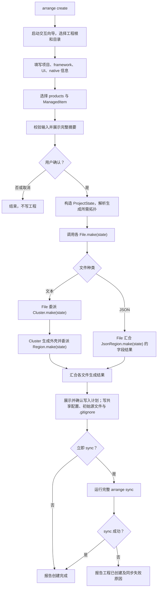

### 完成条件

- 工程根有合法 `arrange.project.yaml`，按配置生成所需 UI/native 初始文件和最小源文件。
- create 的生成结果与后续 CONFIG 使用同一套定义。
- local 尚未准备时由后续 SETUP 负责；选择立即 sync 不意味着同步必然成功。

## `arrange adopt`

### 目标与输入

收编已有 UI/native 工程。保持选择新建或复用、复制或原位引用的交互；项目已在 CWD 对应位置时不重复复制，目录名不同于默认值时可询问是否改名。

native 由用户明确目录、`native.target` 和项目配置，不分析 CMake 正文来反推字段或定位区块。UI 可读取 package.json 等结构化文件展示现状，由用户提供并确认工程配置。选择托管的文本内容通过同一套 Wrapper/Marker 交互接入，不恢复旧的智能文本候选或反哺配置流程。

### 流程

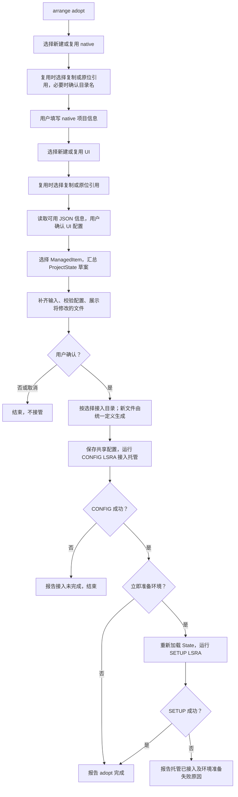

### 完成条件

- 配置完整并经用户确认，所选托管通过 CONFIG 接入。
- 既有文本区块通过用户指定的 Wrapper 建立定位，未托管内容不被接管。
- 后续 sync 从保存的 State 推导拓扑，不依赖 adopt 的一次性内存坐标。

## `arrange sync`

参数选择见 [CLI 母文档](../../../arch/31-ArrangeCLI与工程模式.md#命令)。

### 完整同步编排

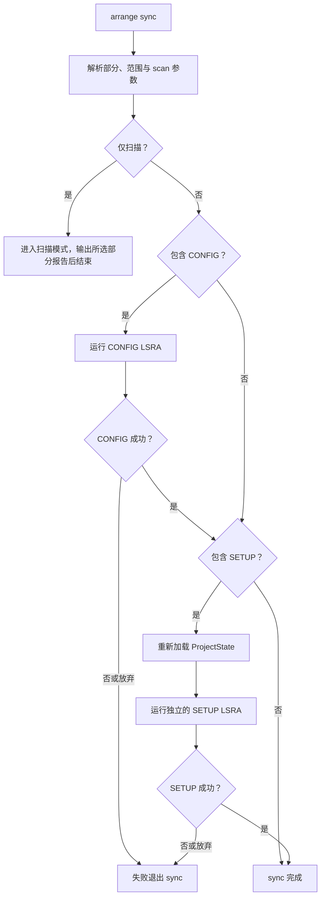

### CONFIG LSRA

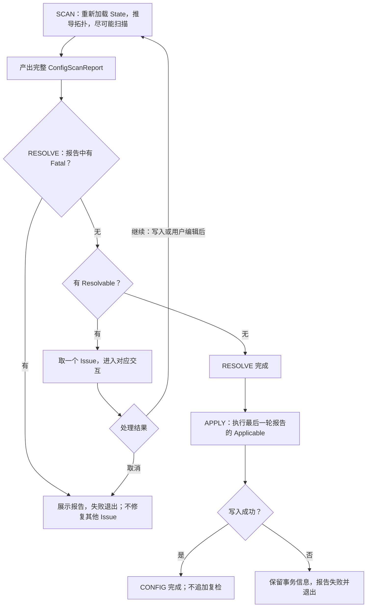

### CONFIG SCAN 的遍历

父级门控与四类结果使用[母文档的扫描矩阵](../../../arch/32-ArrangeCLI托管与同步模型.md)，下图展开当前扫描器的遍历顺序。

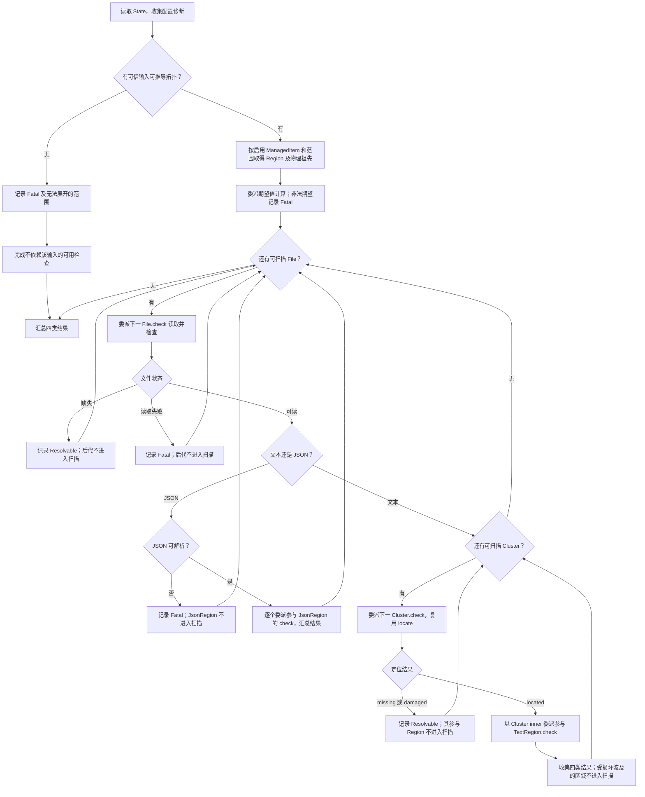

期望非法和父级失败都只阻断依赖该输入的判定；其他具有可信输入的对象继续扫描。报告引用与验收示例见 [SCAN 结果各项与对策](SCAN结果各项+对策.md)。

### CONFIG RESOLVE 的一次交互

此处的入口已经通过 Fatal 检查。每次只处理一个 Resolvable；所有编辑返回完整 SCAN，不继续消费旧报告。

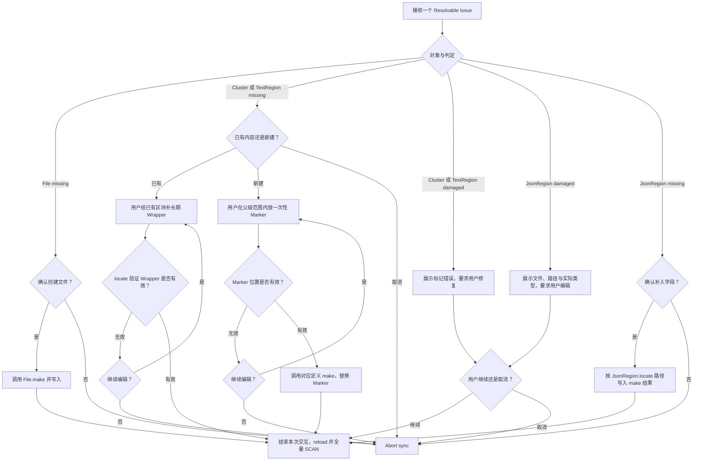

若发现用户在交互期间同时修改了 YAML，结束当前 Issue 的交互并回到完整 SCAN，不再依据旧 expect 或旧托管开关写入。位置验证不通过时不写入，用户可修复或取消。对应处理的语义边界以母文档为准。

### CONFIG APPLY

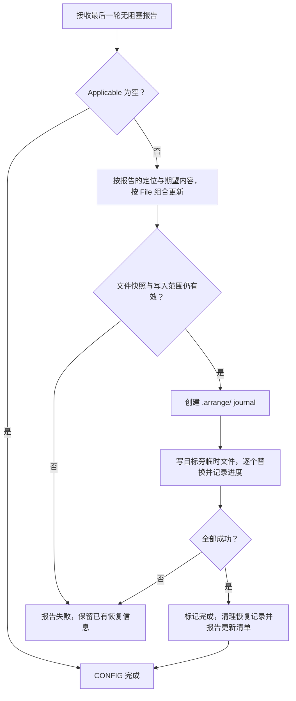

区间换算与替换规则见[恢复与应用](../../../arch/32-ArrangeCLI托管与同步模型.md#config-的恢复与应用)，写入保护见[事务约定](../../../arch/32-ArrangeCLI托管与同步模型.md#arrange-与写入失败)。

### 扫描模式

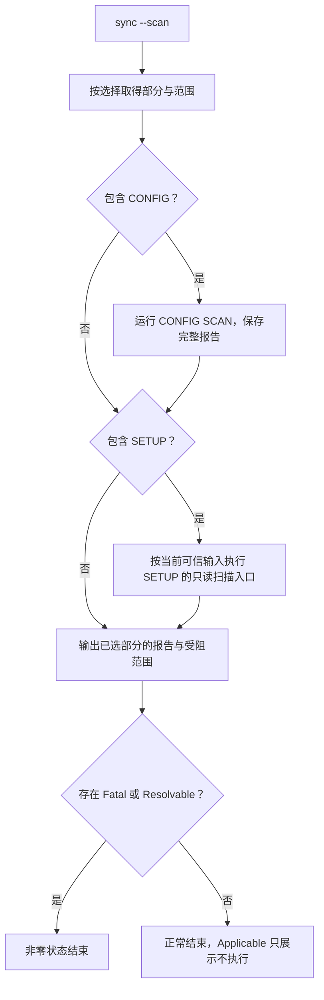

SETUP 在扫描模式中观察当前实际状态，不假定 CONFIG 的 Applicable 已被执行；无法开展的范围必须说明。扫描对象与分类以[托管母文档](../../../arch/32-ArrangeCLI托管与同步模型.md)为准。

### SETUP LSRA

SETUP 管环境和设施准备状态，使用项目需求与本机设置，运行独立 LSRA。完整 sync 中，它在 CONFIG 成功并重新加载 State 后开始。

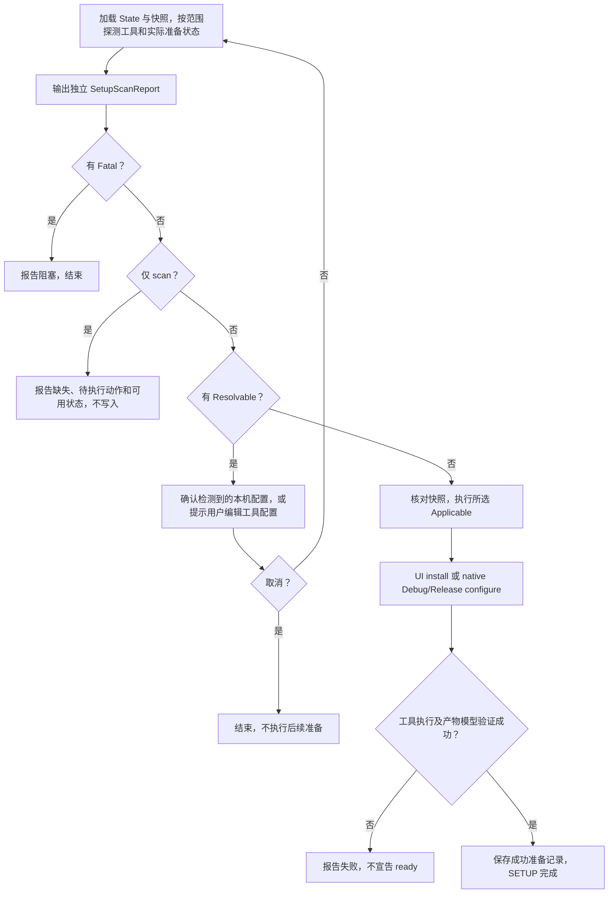

SETUP 的具体检查和准备记录归属见[托管母文档](../../../arch/32-ArrangeCLI托管与同步模型.md)；平台与工具契约见[CLI 母文档](../../../arch/31-ArrangeCLI与工程模式.md#版本与工具链)。

## `arrange dev`

### 目标

拉起开发环境和测试程序。包含 native 时，每次都执行正式 Standalone 增量构建，再定位产物；不静默修改工程托管配置。各 flavor/范围的资源来源以[CLI 母文档](../../../arch/31-ArrangeCLI与工程模式.md#dev)为准。

### 流程

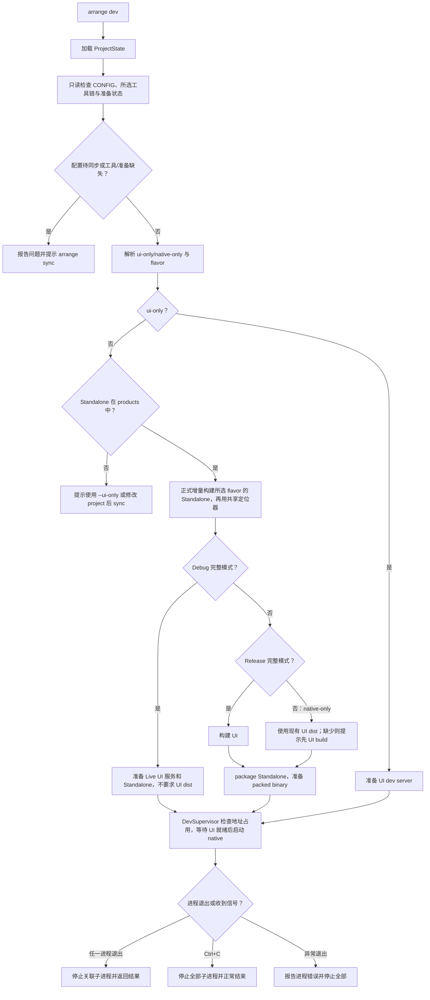

地址占用、准备超时、启动失败和提前退出均结束监管并释放资源。Ctrl+C 是正常结束，不应渲染为错误。Release 和 native-only 不由 CLI 启动 UI 服务，但不覆盖 native 的 App source 选择；具体边界见[CLI 母文档](../../../arch/31-ArrangeCLI与工程模式.md#dev)。

---

## `arrange build`

### 目标

构建可用的 UI/native 产物。默认 flavor 为 `release`，默认 products 来自 ProjectState；完整构建默认继续进入 pack，`--no-pack` 可关闭。

### 流程

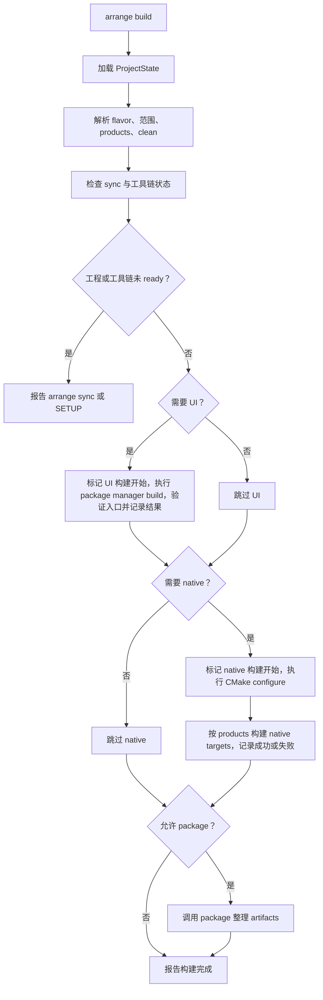

`--ui-only` 不执行 native，也不 pack；`--native-only` 不执行 UI，也不 pack；`--no-pack` 只跳过 pack。任何构建失败均不进入后续 pack。build 结尾说明打包去向（打包完成、已跳过、或因范围未打包），pack 完成时列出交付目录、产品位置、二进制大小与清单。`--clean` 范围和构建记录语义见[CLI 母文档](../../../arch/31-ArrangeCLI与工程模式.md#build)。

---

## `arrange pack`

### 目标

只整理已有的 UI/native 构建产物，不 install、不 configure、不 build。

### 流程

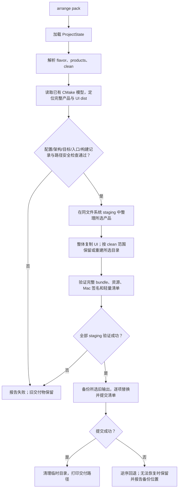

产物布局、构建记录缺失时的手工产物边界、clean/回退与 Mac 签名策略见[CLI 母文档](../../../arch/31-ArrangeCLI与工程模式.md#交付物布局与提交)。package 不以模拟测试通过代替宿主运行验收。

---

## 后续施工入口

当前实现与平台验收记录见[第三期工作区](M2.2的最后工作中.md)，模型接口见[托管母文档](../../../arch/32-ArrangeCLI托管与同步模型.md#物理定义接口)。Demo 迁移与旧脚本废除延后，不阻塞临时真实工程验收。

## 完成判据

- 命令实现与对应 Mermaid 流程一致，失败、取消与扫描模式有明确出口。
- CONFIG 满足[报告验收案例](SCAN结果各项+对策.md)，特别是完整收集四类结果、父级阻断后不扫描子项、每轮只修一个 Issue 和重扫。
- create/adopt 复用统一定义，受管文本以 Wrapper 定位，不引入正文反向解析。
- SETUP 独立验收工具、安装结果、configure 模型与准备记录，不把 CONFIG 的矩阵直接当作其实现。
- build/pack 的失败不得宣告成功或先破坏旧交付；dev 结束后没有关联长进程残留。
- clean/storage/recover 的确认后重查、资源占用、归属核验和中断恢复均有真实执行验证；扫描与取消预览不执行清理、修复或恢复。
- Windows/Mac 的真实执行记录分别保存；本轮 Windows 结果与 Mac 待验收项见[存储维护与验收优化记录](20261013-CLI存储维护与验收优化.md)。

## 维护命令执行规格

以下逐项规定维护命令的执行与交互。参数契约见[CLI 母文档](../../../arch/31-ArrangeCLI与工程模式.md#工程与用户级维护命令)，目录归属与缓存引用见[用户目录母文档](../../../arch/35-Arrange用户目录与源码缓存.md)，资源取得与等待见[资源协议](../../../arch/36-ArrangeCLI资源占用与进程生命周期.md)，事务格式与恢复边界见[托管模型](../../../arch/32-ArrangeCLI托管与同步模型.md#持久事务与独立恢复)。

修改命令必须先展示计划并交互确认；非交互环境不能代替用户确认，可使用 `--scan`。预览、未选择内容或确认前取消均不执行修改；执行中断按持久事务报告恢复入口。参数错误、占用失败、计划变化及执行错误报告失败，不宣告完成。

### `arrange clean`

#### 目标与参数

清理当前工程生成结果，独立于 `build --clean` 的清理后构建行为。

```text
arrange clean [--ui-only | --native-only | --artifacts-only]
              [--artifacts] [--flavor debug|release] [--scan]
```

| 参数 | 本次计划范围 |
|---|---|
| 默认 | UI 输出与本平台当前架构的 Debug、Release 构建树，保留交付物 |
| `--ui-only` | 仅 UI 输出及其构建记录 |
| `--native-only` | 仅 native 构建树及其构建记录 |
| `--artifacts-only` | 仅清单确认归属的交付物 |
| `--artifacts` | 在默认范围中加入受管交付物 |
| `--flavor debug\|release` | 仅缩小 native 范围；默认范围中的 UI 仍清理 |
| `--scan` | 取得所选范围只读占用，展示计划后退出 |

三个单范围参数互斥，也不能与 `--artifacts` 混用；`--flavor` 不用于 `--ui-only` 或 `--artifacts-only`。

#### 流程

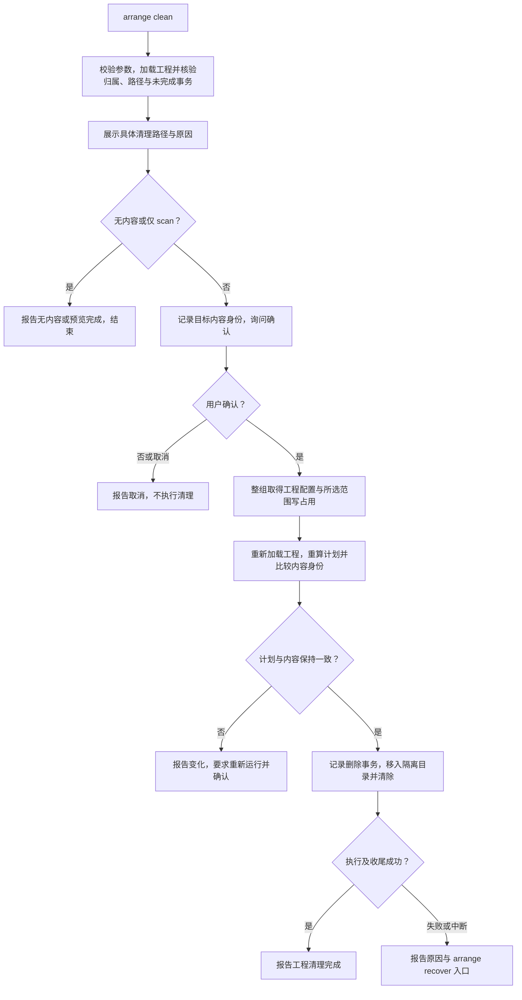

#### 完成与退出条件

- 仅移除计划内生成结果和相应构建记录；保留源码、依赖、配置、日志、恢复材料及用户额外交付文件。
- 无有效归属清单的手工交付物不猜测删除；损坏清单、路径重叠、危险链接或未完成事务阻止执行。
- `--scan` 遇到资源忙立即报告，不能以不稳定视图宣告扫描成功。正常执行按资源协议等待，可取消。
- 清理执行失败或中断时保留恢复所需记录；删除事务只提供继续完成，不提供撤销删除。

### `arrange storage inspect`

#### 目标与输入

查看本用户工程登记及受管资源，可在工程外运行，无范围参数。

```text
arrange storage inspect
```

#### 流程

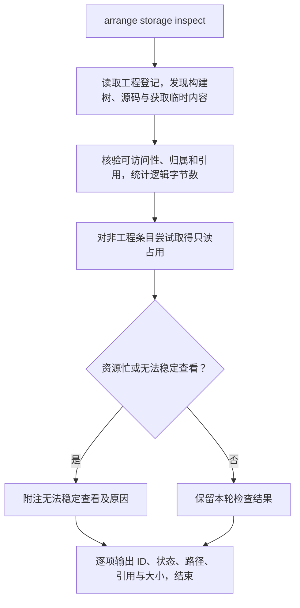

#### 完成与退出条件

- 逐项展示记录、内容、归属、工程、准备与引用事实，并输出具体原因、阻断路径及清理结论；状态与判定依据见[存储检查母文档](../../../arch/35-Arrange用户目录与源码缓存.md#存储检查事实与清理判定)。
- 工程登记不统计大小；资源统计不完整时标明“至少”。结果是本轮快照，占用检查失败时明确附注。
- 不登记工程，不执行删除、修复或事务恢复；归属和引用未知时报告不确定性。

### `arrange storage clean`

#### 目标与参数

选择释放本用户可确认安全清理的资源，可在工程外运行。

```text
arrange storage clean [--scan]
```

候选包括归属明确的孤儿构建树、引用已完整核验的无引用依赖源码及可识别的获取临时内容。扫描同时列出排除原因；没有候选不等于没有库存。外部目录、运行时数据和归属或引用未知的资源不进入候选；不提供强制删除参数。

#### 流程

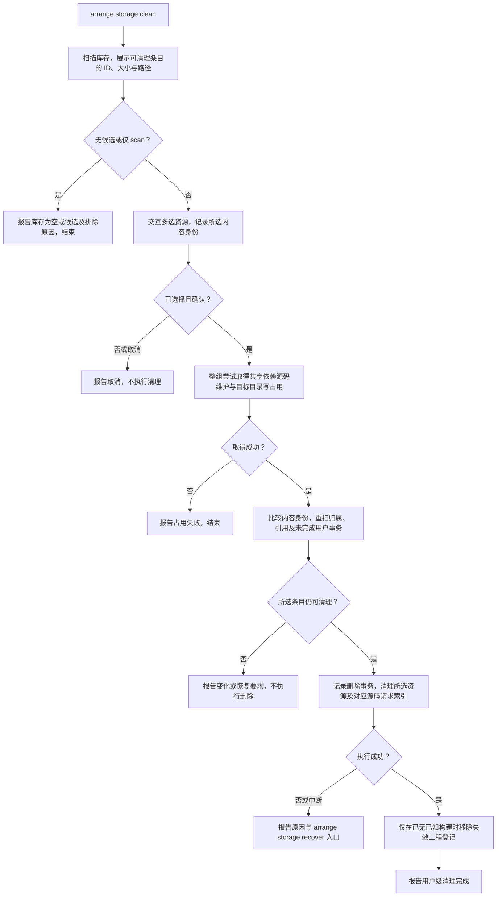

#### 完成与退出条件

- 只处理用户所选条目；确认后有内容、归属或引用变化必须重新查看，不能沿用旧计划。
- 资源忙立即失败；有未完成用户事务时先要求 `storage recover`。不会主动停止其它命令或跳过占用检查。
- 正常工程登记保留；失联或失效登记仍有已知构建时保留，以便继续追踪。
- 执行失败或中断保留事务；清理事务只可继续完成。

### `arrange storage repair <id>`

#### 目标与参数

按缓存记录的确切 commit 重新获取共享依赖源码，不升级依赖版本。

```text
arrange storage repair <id> [--scan]
```

`id` 使用 inspect 输出的 `deps-src:<16位十六进制键>`，也接受省略 `deps-src:` 的键；旧 ID 不作别名。`--scan` 仅展示源码路径与受影响构建，不发起修复网络请求。

#### 流程

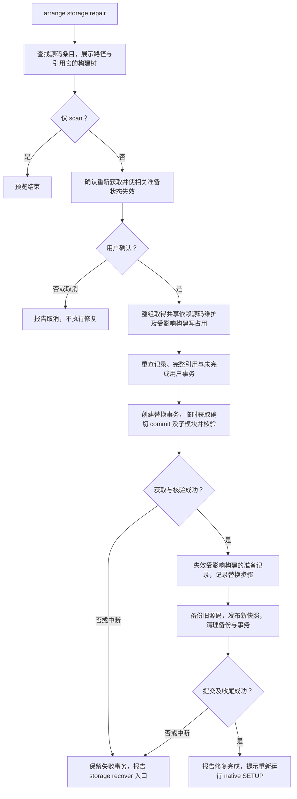

#### 完成与退出条件

- 条目不存在、记录损坏、引用不完整或存在未完成用户事务时报告失败；不能猜测来源或迁移旧格式记录。
- 按资源协议等待占用，允许取消；获取失败不得发布半成品源码。
- 成功只表示源码修复完成；受影响工程须重新运行 `arrange sync --setup --native` 才能恢复准备状态。
- 暂存未完成的替换事务仅可回退清理；进入替换阶段后由实际文件状态决定可继续或可回退。

### `arrange recover [id]`

#### 目标与参数

恢复当前工程 `.arrange/transactions` 内的持久事务，可用于初始化尚未完成、工程配置尚未齐全的目录。无需先安装 Framework 或完成 SETUP。

```text
arrange recover [id] [--scan]
```

无 `id` 时只列事务；有 `id` 时展示目标路径、冲突和当前实际可用动作。`--scan` 展示后退出；继续、回退通过交互选择，不提供强制覆盖或强制解锁参数。

#### 流程

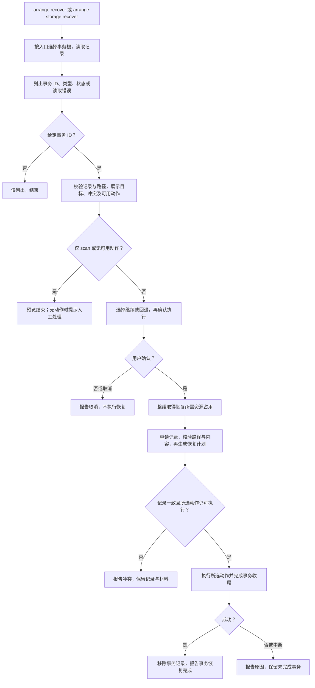

#### 完成与退出条件

- 可用动作按当前文件事实计算：文件写入、初始化和替换可在满足条件时继续或回退；删除只有继续。
- 用户新增或修改的内容不能被强行覆盖或删除；源内容消失、备份缺失等情况可能使动作不可用。
- 损坏或不认识的记录须报告人工处理；没有可用动作不输出“事务恢复完成”。
- 恢复成功完成事务收尾；失败或执行取消继续保留恢复材料。外部包管理器或编译器副作用不属于文件事务回退范围。

### `arrange storage recover [id]`

#### 目标与参数

恢复 `~/.arrange/transactions` 内的用户级清理、源码修复等事务，可在工程外或原工程已不存在时执行。

```text
arrange storage recover [id] [--scan]
```

#### 流程与完成条件

使用上一节恢复流程，但从用户目录读取事务，按受管用户资源与登记构建路径核验恢复范围；不读取当前目录的工程事务。无 ID 列出、有 ID 展示与选择、scan、取消、冲突及完成出口均与工程级恢复一致。

用户级清理失败提示此入口；源码修复事务完成后，若相关准备记录已失效，仍须在受影响工程重新运行 native SETUP。不能用用户级恢复入口代替工程级事务恢复。
